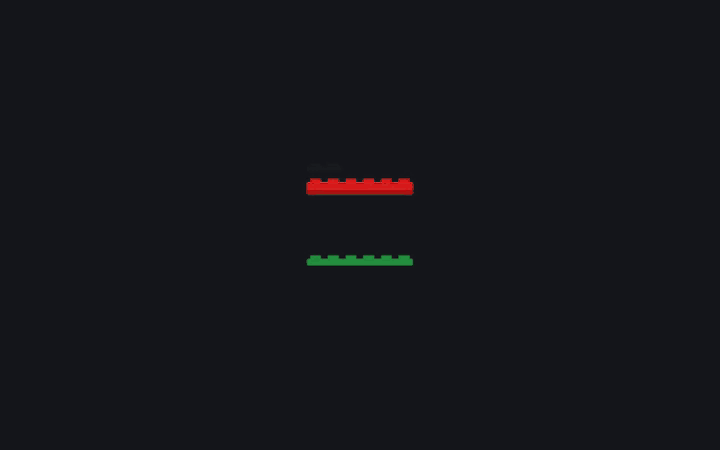
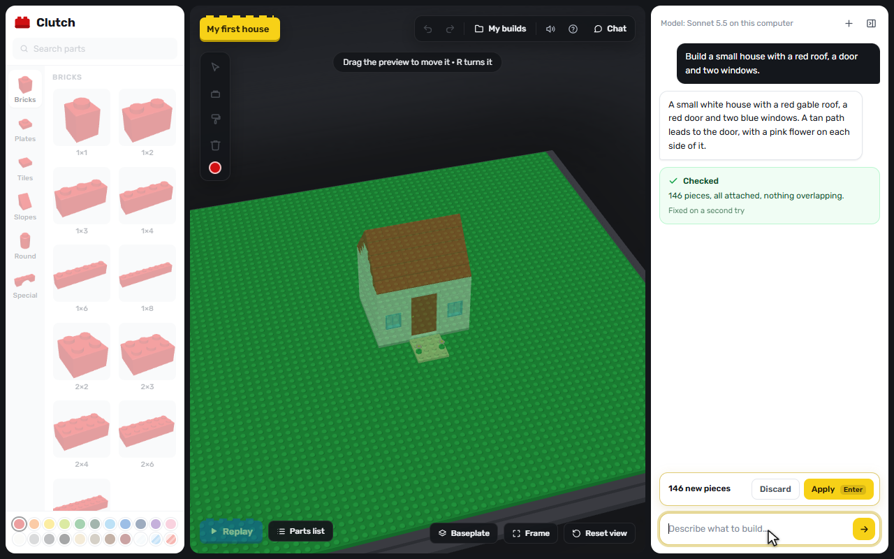
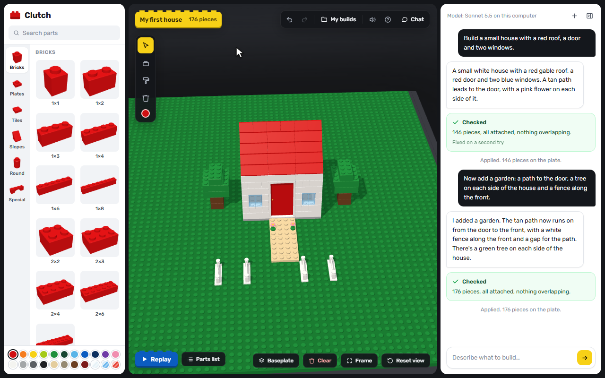
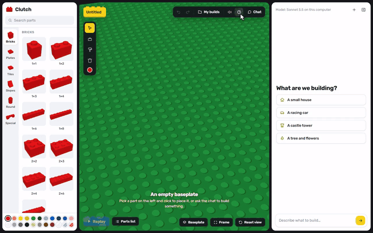
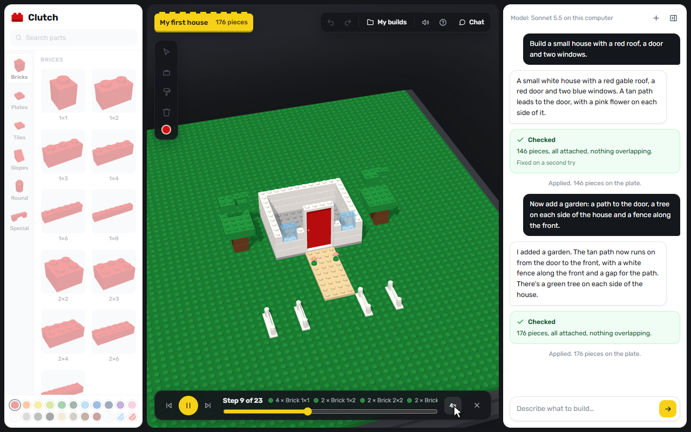
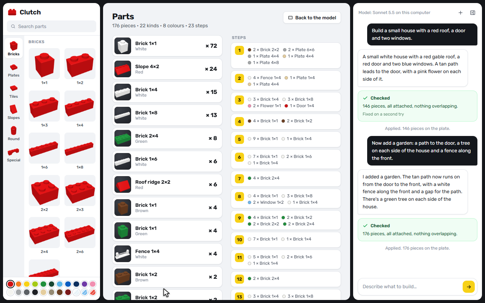

# Clutch

**Build with bricks in your browser. Describe what you want, check the preview, and watch it snap together.**

Named after clutch power, the grip that holds two bricks together.

<p align="center">
  
</p>

<p align="center"><em>A real recording: one request builds a house, a second adds a garden to it, and Build replays it. Only the wait for the model is sped up. <a href="docs/media/demo.mp4">Sharper video (MP4)</a>.</em></p>

## Start it

You need [Node.js](https://nodejs.org) 22 or newer. The chat also needs [Claude Code](https://claude.com/claude-code) installed and signed in on your computer.

```bash
npm install
npm run dev
```

Then open **http://127.0.0.1:5173/** in your browser. On Windows, you can double-click `start-local.bat` instead, which installs what is missing and opens the page for you.

Clutch only runs on your own computer for now.

## Ask the chat to build

Type what you want. Your request shows up as a see-through preview, so nothing changes until you press **Apply**. **Discard** throws it away.

<p align="center">
  
</p>

Before you see a preview, every piece is checked: nothing can overlap, and every piece has to connect through studs back to the baseplate. If there is a problem, the model gets exactly one chance to fix it. The green card tells you how it went, and a yellow one says what is still wrong.

Then keep going. The chat always sees the current build, so you can add to it, change colours or take things away.

<p align="center">
  
</p>

## Or build by hand

Pick a part on the left, pick a colour, and click the baseplate. A ghost shows where the piece will land, and pieces stack on whatever is under the pointer.

<p align="center">
  
</p>

| Input | What it does |
|---|---|
| Left drag / right drag / scroll | Orbit / pan / zoom |
| V, B, P, E | Select, Place, Paint, Erase |
| R | Rotate |
| Alt + click | Pick up a part and its colour |
| G, C | Move or copy the selected piece |
| Delete | Delete the selected piece |
| Esc | Stop, or deselect |
| F | Frame the build |
| Ctrl+Z, Ctrl+Y | Undo, redo |
| ? | Show these in the app |

## Watch it go together

**Build** plays your model from the baseplate up, step by step, like the pages of an instruction booklet. You can pause, step through or change the speed. The **Parts** tab lists every piece you need and every step.

<p align="center">
  
  
</p>

## Keep your work

- **Autosave:** builds save by themselves in this browser. **Open** shows your latest 24.
- **Download:** saves a `.clutch` file you can keep or move to another computer. Open it again with **Open → Open a file…**.
- **Share:** copies a link with the whole build packed inside it, and nothing is uploaded. While Clutch runs locally, the link only works on your own computer, so use Download to give a build to someone else.

## The chat and what it costs

The chat runs through the Claude Code CLI signed in on your computer, using Claude Sonnet by default. There is no API key to set up. With a Claude subscription, each message counts toward your plan's usage limits rather than being billed separately. Everything else, including building by hand and Build, makes no AI calls at all.

The model can only return build instructions: it has no tools, so it cannot touch your files or run commands.

To change the model, copy `.env.example` to `.env.local`:

| Setting | Effect |
|---|---|
| `CLUTCH_CLAUDE_MODEL` | `sonnet` by default, which follows the latest Sonnet. Use a full name, such as `claude-sonnet-4-6`, to pin one. |
| `CLUTCH_CLAUDE_EFFORT` | `medium` by default. Higher builds better and takes longer. |
| `CLUTCH_CLAUDE_BIN` | The path to `claude`, if it cannot be found automatically. |

## The rules

- The baseplate is 48 × 48 studs, and builds can reach 32 bricks tall with up to 3000 pieces. One chat reply can add up to 1500.
- Pieces sit on a stud grid and turn in quarter turns. They cannot overlap.
- There are 44 parts: bricks, plates, tiles, slopes, round parts, arches, windows, doors, fences, wheels and flowers, in 22 colours.
- A piece is attached when it grips a stud, in a chain back to the baseplate. By hand, a piece with nothing to grip is allowed and flagged, and the chat has to fix them.

## How it works

```
        "Build a small house with a red roof"
                        |
                        v
             +---------------------+
             |     Local server    |   the request, the build as text,
             |  server/api.ts      |   and the earlier chat
             +---------------------+
                        |
                        v
             +---------------------+
             |    Claude Code CLI  |   no tools, and the reply must match
             |  server/claude-cli  |   a JSON schema of actions
             +---------------------+
                        |
                        v
             +---------------------+
             |    Check the build  |   collisions and floating pieces go
             |  core/actions.ts    |   back to the model once, in detail
             +---------------------+
                        |
                        v
             +---------------------+
             |    Ghost preview    |   the same actions run again in the browser,
             |  Apply or Discard   |   so what was checked is what gets built
             +---------------------+
```

The model works in big actions (`walls`, `fill`, `roof`, `voxels`) and exact ones (`place`). The big actions lay real pieces with staggered joints, so a whole house is a few lines. Every action runs against the same rules as a piece placed by hand.

Clutch is built to stay light, even on a weak computer:

| What | How |
|---|---|
| Language | TypeScript and Three.js, with no UI framework |
| Pieces | One instanced mesh per part, so a large build is a few dozen draw calls |
| Baseplate | Its studs are a painted texture: two triangles instead of over 100,000 |
| Pointer | A ray walked through the occupancy grid, so hovering does not slow down as a build grows |
| Drawing | Only when something changed, so an idle page draws nothing |
| Slow devices | Quality steps down by itself when drawing falls behind, and remembers for next time |

```
src/core/      the rules, with no browser code; the server runs them too
  parts.ts       the catalogue: footprints, studs, what grips
  grid.ts        occupancy, collisions, the attachment check
  actions.ts     what a list of chat actions builds
  tiling.ts      turns cells into real pieces, with staggered joints
  steps.ts       build order and the parts list
src/render/    Three.js: the stage, generated models, instancing, sound, thumbnails
src/app/       the editor: store, tools, sidebar, chat, replay, projects, landing
server/        the local chat API, the CLI adapter and the prompt
tests/         unit and server tests; e2e/ drives the real editor in Chrome
bench/         real requests through the real chat, and the README's recordings
```

## Development

```bash
npm test            # the rules, the server and the CLI adapter
npm run test:e2e    # the real editor in Chrome (needs npm run dev running)
npm run perf        # frame times on a 3000 piece build
npm run landing     # what the landing page costs (CLUTCH_SOFTWARE=1 for no GPU)
npm run bench       # real prompts through the real model, with pictures
npm run media       # re-records the pictures and videos here (needs ffmpeg)
npm run build       # type checks and a production build
```

`npm run bench` and `npm run media` send real chat messages. The other commands make no AI calls.

LEGO is a trademark of the LEGO Group, which does not sponsor, authorize or endorse this project.
